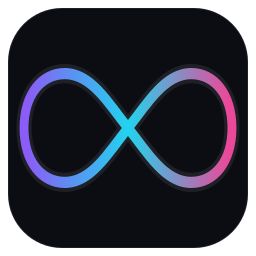

<p align="center">
  
</p>

<h1 align="center">Infinite OS</h1>

<p align="center">
  <strong>A local-first AI operating workspace for chat, code, browser and PC automation, builders, and everyday work.</strong>
</p>

<p align="center">
  <a href="https://github.com/Anthony5109/Infinite-OS/actions/workflows/ci.yml"></a>
  
  
  
</p>

---

## What is Infinite OS?

Infinite OS is a native desktop application that brings an AI assistant, a coding workspace, a browser controller, and a set of build tools into one place. It runs on your machine, keeps its data on your machine, and lets the assistant act through real tools instead of only producing text.

The app is built with **Electron, React, TypeScript, and Vite**. A Manifest V3 browser extension provides browser control over a local WebSocket bridge, and an optional bundled PC Live Map runtime provides screenshot-free desktop state for automation.

> **Project status:** active development. Interfaces and internal APIs may change between releases. Review the [license](#license) before using the project.

## Highlights

- **One workspace** — chat, files, terminal, editor, browser, projects, and automation share a single window and a single command palette.
- **Local-first by default** — conversations, memory, settings, and account profiles live under `~/.infinite-ai`. No telemetry is sent by the app itself.
- **Per-account isolation** — every account gets its own profile directory. Signing into a different account cannot read or inherit another account's data.
- **Real browser control** — the bundled MV3 extension drives a normal Chrome or Edge session: open tabs, navigate, read pages, fill forms, click, extract links, and take screenshots.
- **Desktop automation** — optional PC Live Map reads window, control, and input state without screenshots, and can execute clicks and keystrokes.
- **Bring your own models** — use a local Ollama model or connect a hosted provider with your own key. Credentials stay on your machine.
- **Build from a prompt** — app and website builders, a visual canvas, and deployment helpers.
- **Extensible tools** — a typed tool registry, plugin and MCP support, multi-agent teams, and a self-extension surface guarded by safety checks.
- **Fast and keyboard-first** — a lightweight splash, a global command palette, and keyboard navigation throughout.

## Requirements

| Requirement | Details |
| --- | --- |
| Node.js | 20 or newer |
| Package manager | npm, pnpm, or Bun |
| OS | Windows 10/11, macOS, or Linux |
| Browser | Chrome or Edge for the optional browser bridge |
| Local models | Optional. [Ollama](https://ollama.com) is detected automatically. |

## Quick start

```bash
git clone https://github.com/Anthony5109/Infinite-OS.git
cd Infinite-OS
npm install
npm run dev
```

`npm run dev` starts Electron with Vite hot reload.

### Useful commands

```bash
npm run typecheck     # TypeScript checks for main, renderer, and e2e
npm test              # Vitest unit and integration suite
npm run test:e2e      # Playwright end-to-end suite (builds first)
npm run build         # Typecheck and production bundle
npm run build:win     # Windows installer and portable build
npm run build:mac     # macOS DMG
npm run build:linux   # Linux AppImage
```

## Browser bridge

Infinite OS can control a real browser through the `extensions/infinite-os-bridge` extension.

1. Open **Settings → Browser Bridge** in the app.
2. Choose **Install extension**. The app copies the extension to a local folder and opens the browser's extension page.
3. Enable **Developer mode**, choose **Load unpacked**, and select the folder the app shows.
4. Return to the app. The bridge indicator turns green when the extension connects.

On first launch the app can also create a dedicated Chrome profile, so the assistant never touches your everyday browsing profile unless you explicitly install the extension there.

The bridge listens only on `127.0.0.1`, authenticates with a token stored at `~/.infinite-ai/bridge-token`, and is not exposed to the network.

## Privacy and account isolation

- Application data is stored under `~/.infinite-ai`.
- Each signed-in account is mapped to `~/.infinite-ai/profiles/<uid>`, and the app relaunches when the profile changes.
- API keys and provider credentials are stored locally. They are never bundled into the repository.
- The local owner record starts generic and is linked to the account that signs in. A new installation never inherits another person's name, email, or local privileges.
- The app contains no analytics or crash-reporting SDK.

See [SECURITY.md](SECURITY.md) for reporting a vulnerability.

## Architecture

```
src/
  main/       Electron main process: agents, tools, providers, IPC, bridge, storage
  preload/    Typed context bridge exposed to the renderer
  renderer/   React UI, Zustand stores, views, and components
  shared/     Types and IPC contracts shared by all processes
extensions/
  infinite-os-bridge/   Manifest V3 browser extension
pc-live-map/            Optional screenshot-free desktop state runtime
resources/              Icons and local voice scripts
e2e/                    Playwright end-to-end tests
```

The renderer never receives Node.js access directly. All privileged work goes through typed IPC handlers in the main process, and the browser bridge is a separate authenticated WebSocket channel.

## Testing

The project uses Vitest for unit and integration tests and Playwright for end-to-end tests. Live browser tests are opt-in and hit the real network:

```bash
INFINITE_LIVE=1 npm test -- src/main/bridge/live-web.test.ts
```

Normal test runs use isolated temporary homes and stubs, so they do not read or modify your real `~/.infinite-ai` data.

## Contributing

Contributions are welcome. Read [CONTRIBUTING.md](CONTRIBUTING.md) before opening a pull request, and run the checks below first:

```bash
npm run typecheck
npm test
npm run build
```

By contributing you agree that your contribution is licensed to the project as described in the [LICENSE](LICENSE).

## License

Infinite OS is **source-available**, not OSI open source.

**Copyright © 2026 Anthony Matthews. All Rights Reserved.**

You may study, run, modify, and improve the project for personal, educational, research, and development purposes, and you may submit improvements back to the official repository. You may not claim ownership of the project, rebrand it, redistribute it as a separate product, or use it commercially without written permission. See [LICENSE](LICENSE) for the complete terms.

## Disclaimer

Infinite OS can run commands, edit files, control a browser, and automate a desktop when you grant it permission. Review actions before approving them, keep backups of important data, and use the safety controls provided by the app. The software is provided "as is", without warranty of any kind.
